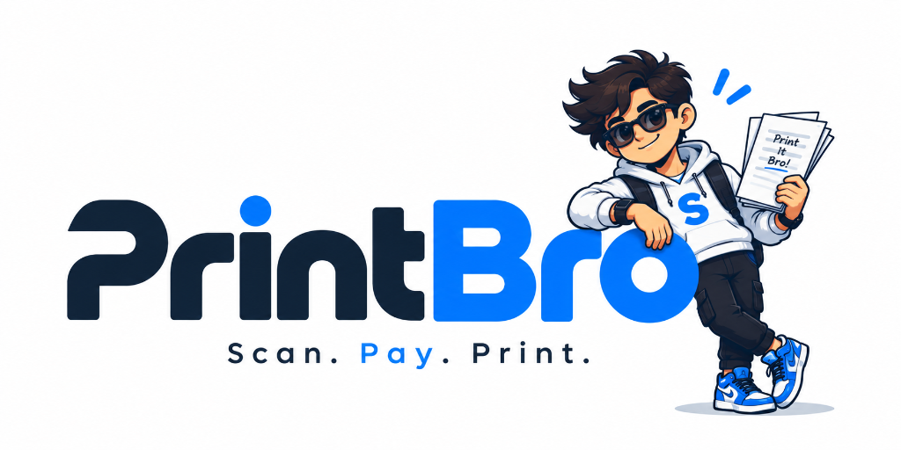

<p align="center">
  
</p>

# Project Brief Report: PRINT BRO
## Smart Campus Printing Kiosks & Digital Services Network
**Presented to:** Centre for Innovation and Entrepreneurship (CIE) Faculty  
**Institution:** G. Pulla Reddy Engineering College (GPREC), Kurnool  
**Date:** October 2026  
**Document Status:** Pitch Deck Companion & Post-Discussion Brief Report  

---

### Executive Summary

**Print Bro** is an autonomous, IoT-enabled self-service printing kiosk network engineered specifically for collegiate and institutional campuses. 

Currently, thousands of college students rely on a tiny number of traditional Xerox shops surrounding the campus. During morning hours and assignment/record submission deadlines, these shops become acute bottlenecks where students waste 20 to 45 minutes in lines for a printing task that takes less than 15 seconds of machine time. 

**Print Bro replaces the single, slow, operator-dependent counter with a distributed campus network of smart, automated kiosks.** Students upload their document by scanning a dynamic QR code on their smartphone or using the touchscreen interface, configure their print settings (B/W vs. Colour, page ranges, duplex), complete payment via any UPI app (Google Pay, PhonePe, Paytm), and immediately collect their output.

In addition to transaction-based printing revenue, Print Bro incorporates an interactive digital display screen that unlocks a lucrative **Campus Digital Out-of-Home (DOOH) advertising network**, engaging a captive 18–24 demographic with high purchasing power.

---

### 1. The Problem Statement

#### 1.1 The Operational Bottleneck of Campus Printing
College students have an ongoing, non-negotiable need for physical documentation:
- Weekly laboratory records & observation sheets
- Assignment submissions & tutorial notes
- Major and minor engineering project reports
- Resumes & certificates for campus recruitment drives
- Hall tickets, examination admit cards, and registration slips

Most educational institutions possess only 1 to 2 commercial Xerox shops on or adjacent to the campus. These vendors do not solely handle printing—they simultaneously manage bookbinding, lamination, stationery sales, and document scanning. Consequently, simple 2-page print jobs get hopelessly delayed behind complex 100-page spiral binding orders.

#### 1.2 The 6-Step Manual Operator Dilemma
Each transaction at a traditional counter requires six discrete, manual operator touchpoints:
1. **File Transfer:** Student sends documents through WhatsApp, Bluetooth, or unverified USB pen drives.
2. **File Inspection:** Shop operator searches for the file, downloads it, verifies formatting, and checks page counts.
3. **Print Configuration:** Operator selects correct printer drivers, paper trays, orientation, and color modes.
4. **Billing Calculation:** Manual calculation of cost, followed by cash change handling or manual UPI verification.
5. **Print Spooling:** Machine prints while student and operator wait idle.
6. **Collation & Handover:** Operator collects pages from output bin and hands them to the student.

This manual process takes **3 to 6 minutes per student**. When 50 to 100 students arrive in a 30-minute window prior to morning classes or lab deadlines, the queue length explodes.

#### 1.3 Quantifying the Student Loss
* **Compounded Time Deficit:** A student requiring a 3-page print spends ~12 minutes walking, ~25 minutes queuing, and ~3 minutes at the counter. The actual mechanical print time is **12 seconds**. Over 90% of the elapsed time is unproductive waiting.
* **Privacy & Security Risks:** Transmitting personal academic records, resumes, and identification documents to a third-party WhatsApp number or public PC exposes students to privacy breaches and malware infections.
* **Academic Penalties:** Sudden shop delays cause students to arrive late to lectures or incur late-submission grade deductions.
* **Absence of 24/7 Access:** Traditional shops operate only during standard commercial hours, stranding hostel residents preparing late at night or early in the morning.

---

### 2. The Print Bro Solution

Print Bro decouples printing from the physical shop counter by transforming it into an autonomous, 100% self-service digital utility.

```
+---------------+     +------------------+     +-----------------+     +-----------------+     +-----------------+
|   1. UPLOAD   | --> |   2. CONFIGURE   | --> |   3. PAY (UPI)  | --> |    4. PRINT     | --> |   5. COLLECT    |
| Scan QR / Web |     | Pages, B/W/Color |     | Dynamic QR Code |     | Cloud Autospool |     | Output Tray Bay |
+---------------+     +------------------+     +-----------------+     +-----------------+     +-----------------+
                           (Average Total Turnaround Time: < 45 Seconds)
```

#### Key Functional Features
1. **Zero Operator Overhead:** The entire process is initiated, configured, and completed directly by the student.
2. **Contactless Mobile Integration:** Students do not need to install heavy native apps. Scanning the kiosk QR code opens a lightweight Progressive Web App (PWA) on their smartphone.
3. **Automated File Sanitization & Privacy:** Documents are streamed via encrypted HTTPS, processed into raw print spool streams, and immediately expunged from the kiosk memory post-completion.
4. **Instant Dynamic UPI:** The kiosk generates a precise, job-specific dynamic UPI QR code. The moment payment is verified via webhook (< 2 seconds), printing begins automatically.
5. **High-Speed Industrial Output:** Equipped with commercial duplex laser printing engines capable of 35–45 pages per minute (PPM).

---

### 3. Distributed Campus Architecture

Rather than forcing 4,000+ students through a single shop entrance, Print Bro implements a **mesh network of distributed kiosks** deployed at strategic campus touchpoints:

| Campus Deployment Zone | Target Student Need | Impact |
| :--- | :--- | :--- |
| **Central Library** | Research papers, journals, reference notes, syllabus copies | Silent, self-service printing without disturbing study zones |
| **Academic / Lab Blocks** | Weekly lab records, circuit diagrams, code outputs | Immediate 2-minute walk before laboratory reporting times |
| **Student Hostels (Boys & Girls)** | Late-night exam prep, early morning hall tickets | True 24/7 accessibility when commercial shops are locked |
| **Canteen / Activity Center** | Event posters, club forms, casual notes | High-footfall convenience and peak ad impression visibility |
| **Administrative / Placement Cell** | Resumes, declaration letters, identity verification | Clean, professional prints on demand for job interviews |

---

### 4. Dual-Engine Monetization Strategy

Print Bro does not operate solely as a hardware vending machine; it functions as a **two-sided platform** uniting student utility with high-value digital advertising.

```
                              +------------------------+
                              |       PRINT BRO        |
                              |   CAMPUS PLATFORM      |
                              +-----------+------------+
                                          |
                +-------------------------+-------------------------+
                |                                                   |
                v                                                   v
      STREAM 1: PRINTING UTILITY                          STREAM 2: DOOH ADVERTISING
• B/W & Colour Per-Page Fees                        • Eye-level Kiosk Digital Display
• Bulk Bound Submissions                            • Captive 30-45s Attention Window
• Subsidized Student Pricing                        • EdTech, Fintech, Food & Local Brands
```

#### Stream 1: Transactional Printing Fees
- **B/W Standard Print:** ₹1.50 – ₹2.00 per page (Cost of goods sold: ~₹0.60; Gross Margin: 60–70%).
- **Colour Prints:** ₹5.00 – ₹10.00 per page (Cost of goods sold: ~₹2.00; Gross Margin: 60–80%).
- **Duplex Economy:** Discounted pricing encouraging paper conservation.

#### Stream 2: Digital Out-of-Home (DOOH) Campus Media
- The kiosk is equipped with a high-definition 21.5" or 27" vertical display.
- During active transactions, students are fully engaged with the screen for 30–45 seconds.
- In idle mode, the screen plays high-resolution promotional video loops and campus announcements.
- **Target Advertisers:**
  - *EdTech & Upskilling:* GATE, GRE, CAT coaching, Coding bootcamps, Study abroad agencies.
  - *Student Fintech:* Student credit cards, digital savings accounts, zero-balance wallets.
  - *F&B and Lifestyle:* Nearby cafes, food delivery discounts, local electronics vendors.
  - *College Activities:* Hackathons, symposiums, college fest promotions, administrative circulars.
- **Margin Profile:** Software-driven ad distribution commands **90%+ gross margins**.

#### Stream 3: Institutional SaaS & Managed Services
- Web dashboard licensing for university administration.
- Centralized tracking of faculty quotas, departmental cost centers, and green campus paper consumption audits.

---

### 5. Technical Architecture

Print Bro combines robust edge hardware with a modern cloud backend:

1. **Hardware Enclosure:**
   - 16-gauge sheet metal secure anti-tamper kiosk enclosure.
   - High-yield, network-connected duplex laser print engine (Brother / HP / Canon enterprise OEM).
   - Industrial Raspberry Pi 4 / Intel N100 SBC running an embedded Linux OS with watchdog timer.
   - 15.6" capacitive touchscreen + optical QR scanner module + internal cooling ventilation.

2. **Software Stack:**
   - **Frontend:** Next.js / Tailwind CSS / React touchscreen kiosk interface + mobile PWA.
   - **Backend:** Node.js / Express microservices with Socket.IO for real-time kiosk synchronization.
   - **Print Orchestration:** CUPS (Common Unix Printing System) daemon with PDF rendering pipeline (`pdf-to-printer` / ghostscript) handling automated page scaling and margin clipping.
   - **Payment Gateway:** UPI Payment Gateway integration (Razorpay / Cashfree / PhonePe PG) with sub-second webhook triggers.

---

### 6. Proposed Pilot at G. Pulla Reddy Engineering College (GPREC)

To validate operational viability, student adoption, and hardware resilience, we propose deploying an initial **single-unit pilot prototype** on the GPREC campus.

#### 6.1 Pilot Objectives
1. **User Adoption Rate:** Measure daily print volume and percentage of repeat student users over a 60-day cycle.
2. **Speed & Throughput Validation:** Prove that the average transaction completion time remains under 45 seconds during the 8:30 AM – 9:15 AM surge.
3. **Financial Feasibility:** Calculate true operational cost per page (paper reams, toner consumption, electricity, and maintenance wear).
4. **Payment Gateway Reliability:** Validate seamless UPI completion rates (> 99.2% target success rate).
5. **DOOH Advertiser Trial:** Partner with 2 to 3 local Kurnool educational institutes or food brands to run pilot ad campaigns.

#### 6.2 Implementation Roadmap
- **Weeks 1–2:** Kiosk hardware casing assembly, print driver calibration, and network connectivity tests.
- **Weeks 3–4:** Placement at GPREC Central Library / Mechanical-CSE Corridor with physical signage.
- **Weeks 5–8:** Full student access; collection of qualitative feedback and quantitative telemetry logs.
- **Weeks 9–10:** Pilot outcome report preparation for CIE faculty; review of expansion feasibility.

---

### 7. Problem vs. Solution Matrix

| Factor | Traditional Campus Xerox Shop | Print Bro Autonomous Kiosk |
| :--- | :--- | :--- |
| **Turnaround Time** | 15 – 45 minutes of queuing & delays | **Under 45 seconds total per student** |
| **Workflow** | 6 manual operator steps | **100% automated digital workflow** |
| **Document Privacy** | WhatsApp / USB sharing to public PCs | **Encrypted streaming; instant auto-wipe** |
| **Operating Hours** | 9:00 AM – 6:00 PM (Closed off-hours) | **24/7 accessible in campus buildings** |
| **Location Strategy** | Concentrated at 1 crowded shop counter | **Distributed across libraries, labs & hostels** |
| **Payment Mode** | Loose cash / manual UPI tallying | **Instant dynamic UPI QR code** |
| **Secondary Monetization** | Stationery sales only | **High-margin DOOH digital ad network** |
| **Institutional Control** | Zero campus oversight or data tracking | **Cloud dashboard with full analytics** |

---

### 8. Long-Term Vision

Print Bro aims to develop from an autonomous printing station into the **universal smart utility hub for Indian higher education**. Future roadmap phases include:
1. **Phase 2 — Cloud Scanning Station:** Flatbed scanning module allowing direct upload of handwritten records to Google Drive, email, or DigiLocker.
2. **Phase 3 — Essential Academic Dispenser:** Automated micro-vending compartment for urgent stationery essentials (pens, pencils, exam graph sheets, project covers).
3. **Phase 4 — Unified Campus Smart Card Integration:** Contactless RFID / NFC student ID tap for instant campus wallet deduction.

---

### 9. Discussion & Incubation Support Requested from CIE

We seek the following support and guidance from the Centre for Innovation and Entrepreneurship (CIE) faculty:
1. **Campus Pilot Permission:** Authorization to place one prototype kiosk unit in the GPREC Central Library or academic block with electrical power and Wi-Fi access.
2. **Faculty Mentorship:** Guidance on institutional procurement compliance, safety certifications, and commercial scaling.
3. **CIE Incubation & Grant Guidance:** Direction on applying for student startup seed funding (MSME, NIDHI-EIR, or state innovation grants) to fabricate subsequent production-grade kiosks.

---
*Report prepared for CIE Faculty Evaluation — October 2026*  
*Project Team: Print Bro Innovation Group*
